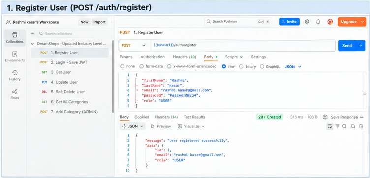
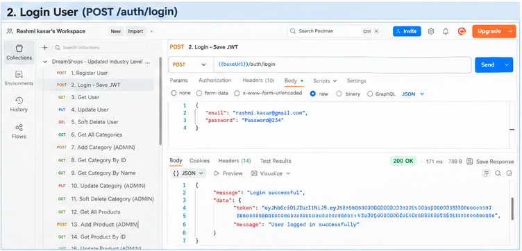
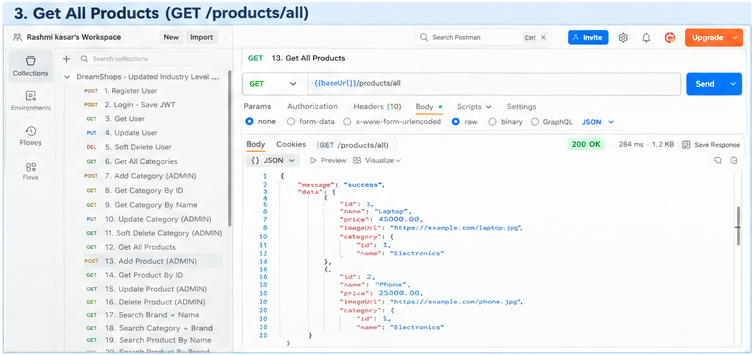
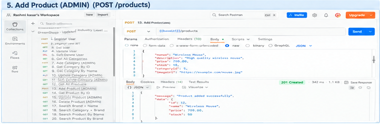
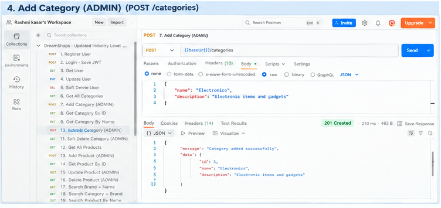
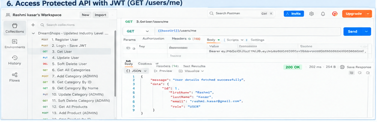

# 🛒 E-Shop -- Spring Boot E-Commerce REST API

A production-style **E-Commerce REST API** developed using **Java 17,
Spring Boot, Spring Security, JWT, Spring Data JPA, Hibernate and
MySQL**.

The application provides user authentication, product and category
management, shopping cart operations, order placement, image management,
validation, role-based authorization, auditing, optimistic locking and
soft-delete support.

------------------------------------------------------------------------

## 📌 Project Overview

**E-Shop** is a backend REST API for an online shopping application.

### Main Features

-   User registration and login
-   JWT-based authentication
-   Role-based authorization (`USER` / `ADMIN`)
-   BCrypt password encryption
-   Product CRUD operations
-   Category management
-   Product image upload/download
-   Shopping cart management
-   Cart item add/update/remove
-   Order placement and order retrieval
-   Inventory management
-   DTO-based API responses
-   Jakarta Bean Validation
-   Custom exception handling
-   Entity auditing
-   Optimistic locking using `@Version`
-   Soft delete with retention-based cleanup
-   Scheduled permanent cleanup of expired soft-deleted records
-   Layered architecture

------------------------------------------------------------------------

## 🧰 Technology Stack

  Technology           Usage
  -------------------- ---------------------------------
  Java 17              Programming language
  Spring Boot 4.0.8    Backend framework
  Spring MVC           REST API development
  Spring Security      Authentication & authorization
  JWT / JJWT 0.12.6    Token-based authentication
  Spring Data JPA      Persistence layer
  Hibernate            ORM
  MySQL                Database
  Jakarta Validation   Request validation
  ModelMapper 3.2.4    Entity ↔ DTO mapping
  Lombok               Boilerplate reduction
  Maven                Build and dependency management
  Postman              API testing

------------------------------------------------------------------------

## 🏗️ Architecture

``` text
Client / Postman
       |
       v
+----------------------+
|   Spring Security    |
| JWT Authentication   |
+----------+-----------+
           |
           v
+----------------------+
|     Controller       |
+----------+-----------+
           |
           v
+----------------------+
|       Service        |
| Business Logic       |
+----------+-----------+
           |
           v
+----------------------+
|      Repository      |
|   Spring Data JPA    |
+----------+-----------+
           |
           v
+----------------------+
|        MySQL         |
+----------------------+
```

### Layer Responsibilities

-   **Controller** -- handles HTTP requests and responses.
-   **Service** -- contains business logic.
-   **Repository** -- communicates with the database.
-   **Entity/Model** -- represents database tables.
-   **DTO** -- controls data exposed through APIs.
-   **Request classes** -- represent incoming request data.
-   **Security layer** -- validates JWT and controls access.
-   **Exception layer** -- handles application errors.

------------------------------------------------------------------------

## 📂 Project Structure

``` text
src/main/java/com/shoppingCart
│
├── config
│   ├── AuditingConfig.java
│   ├── JwtAuthenticationFilter.java
│   ├── SecurityConfig.java
│   └── ShopConfig.java
│
├── controller
│   ├── AuthController.java
│   ├── ProductController.java
│   ├── CategoryController.java
│   ├── CartController.java
│   ├── CartItemController.java
│   ├── OrderController.java
│   ├── UserController.java
│   └── ImageController.java
│
├── model
│   ├── AuditableEntity.java
│   ├── User.java
│   ├── Product.java
│   ├── Category.java
│   ├── Cart.java
│   ├── CartItem.java
│   ├── Order.java
│   ├── OrderItem.java
│   └── Image.java
│
├── repository
├── request
├── response
├── dto
├── enums
├── exceptions
└── service
```

------------------------------------------------------------------------

# 🔐 Authentication & JWT

The application uses **stateless JWT authentication**.

### Authentication Flow

``` text
Register / Login
       |
       v
AuthenticationController
       |
       v
AuthenticationManager
       |
       v
DaoAuthenticationProvider
       |
       v
UserDetailsService
       |
       v
Password Verification
       |
       v
JWT Token Generated
       |
       v
Client stores token
       |
       v
Authorization: Bearer <JWT>
       |
       v
JwtAuthenticationFilter
       |
       v
SecurityContext
       |
       v
Protected API
```

### Security Configuration

-   CSRF disabled because this is a REST API.
-   Session policy is `STATELESS`.
-   `/api/v1/auth/**` is public.
-   Product and category APIs are configured as public.
-   Image download is public.
-   Other APIs require authentication.
-   Admin operations use `@PreAuthorize("hasRole('ADMIN')")`.
-   Passwords are encoded using `BCryptPasswordEncoder`.

------------------------------------------------------------------------

# 🌐 API Base URL

``` text
http://localhost:9091/api/v1
```

------------------------------------------------------------------------

# 🧪 API Testing -- Postman

> **README assets:** All Postman screenshots are stored in the **same directory as this README.md** so the images render directly on GitHub without a separate `screenshots` folder.

> The screenshots below show the API testing workflow in Postman, including request bodies, response status codes, JWT authentication, and protected ADMIN APIs.

## 1. Register User

**POST**

``` text
/api/v1/auth/register
```

Request body:

``` json
{
  "firstName": "Rashmi",
  "lastName": "Kasar",
  "email": "user@example.com",
  "password": "password123"
}
```

Expected successful response structure:

``` json
{
  "message": "Registration successful",
  "data": {
    "token": "<JWT_TOKEN>",
    "message": "User registered successfully"
  }
}
```



------------------------------------------------------------------------

## 2. Login and Get JWT

**POST**

``` text
/api/v1/auth/login
```

Request body:

``` json
{
  "email": "user@example.com",
  "password": "password123"
}
```

The response contains a JWT token.



------------------------------------------------------------------------

## 3. Get All Products

**GET**

``` text
/api/v1/products/all
```

This endpoint is configured as a public product API.



------------------------------------------------------------------------

## 4. Admin Product API with JWT

**POST**

``` text
/api/v1/products/add
```

Headers:

``` text
Content-Type: application/json
Authorization: Bearer <JWT_TOKEN>
```

Example body:

``` json
{
  "name": "Laptop",
  "brand": "Demo Brand",
  "price": 55000,
  "inventory": 10,
  "description": "Business laptop"
}
```

This operation is protected with:

``` java
@PreAuthorize("hasRole('ADMIN')")
```



## 5. Add Category (ADMIN)

**POST**

```text
/api/v1/categories/add
```

The request is authenticated using the JWT token and requires the `ADMIN` role.



---

## 6. Protected API with JWT

Protected APIs require the JWT returned by the login endpoint:

```text
Authorization: Bearer <JWT_TOKEN>
```




------------------------------------------------------------------------

# 📋 API Endpoints

## Authentication

  Method   Endpoint           Access
  -------- ------------------ --------
  POST     `/auth/register`   Public
  POST     `/auth/login`      Public

## Products

  Method   Endpoint                                      Access
  -------- --------------------------------------------- --------
  GET      `/products/all`                               Public
  GET      `/products/product/{productId}/product`       Public
  POST     `/products/add`                               ADMIN
  PUT      `/products/product/{productId}/update`        ADMIN
  DELETE   `/products/product/{productId}/delete`        ADMIN
  GET      `/products/products/by/brand-and-name`        Public
  GET      `/products/products/by/category-and-brand`    Public
  GET      `/products/products/{name}/products`          Public
  GET      `/products/product/by-brand`                  Public
  GET      `/products/product/{category}/all/products`   Public
  GET      `/products/product/count/by-brand/and-name`   Public

## Categories

  Method   Endpoint                                 Access
  -------- ---------------------------------------- --------
  GET      `/categories/all`                        Public
  POST     `/categories/add`                        ADMIN
  GET      `/categories/category/{id}/category`     Public
  GET      `/categories/category/{name}/category`   Public
  PUT      `/categories/category/{id}/update`       ADMIN
  DELETE   `/categories/category/{id}/delete`       ADMIN

## Cart

  Method   Endpoint                             Access
  -------- ------------------------------------ ---------------
  GET      `/carts/{cartId}/my-cart`            Authenticated
  DELETE   `/carts/{cartId}/clear`              Authenticated
  GET      `/carts/{cartId}/cart/total-price`   Authenticated

## Cart Items

  -------------------------------------------------------------------------------------------------
  Method                  Endpoint                                          Access
  ----------------------- ------------------------------------------------- -----------------------
  POST                    `/cartItems/item/add`                             Authenticated

  PUT                     `/cartItems/cart/{cartId}/item/{itemId}/update`   Authenticated

  DELETE                  `/cartItems/cart/{cartId}/item/{itemId}/remove`   Authenticated
  -------------------------------------------------------------------------------------------------

## Orders

  Method   Endpoint                    Access
  -------- --------------------------- ---------------
  POST     `/orders/order`             Authenticated
  GET      `/orders/{orderId}/order`   Authenticated
  GET      `/orders/{userId}/order`    Authenticated

## Users

  Method   Endpoint                   Access
  -------- -------------------------- ---------------
  GET      `/users/{userId}/user`     Authenticated
  POST     `/users/add`               Authenticated
  PUT      `/users/{userId}/update`   Authenticated
  DELETE   `/users/{userId}/delete`   Authenticated

## Images

  Method   Endpoint                             Access
  -------- ------------------------------------ --------
  POST     `/images/upload`                     ADMIN
  GET      `/images/image/download/{imageId}`   Public
  PUT      `/images/image/{imageId}/update`     ADMIN
  DELETE   `/images/image/{imageId}/delete`     ADMIN

------------------------------------------------------------------------

# 🛒 Shopping Cart Flow

``` text
User
 |
 v
Create / Login
 |
 v
Cart
 |
 +----> Add Product
 |
 +----> Update Quantity
 |
 +----> Remove Item
 |
 v
Calculate Total
 |
 v
Place Order
 |
 v
Order + Order Items
 |
 v
Inventory Updated
```

The order service uses a transactional workflow so the order creation,
order items and inventory operations are handled together.

------------------------------------------------------------------------

# 📦 Order Management

When a user places an order:

1.  User is identified.
2.  User's cart is loaded.
3.  Cart items are read.
4.  New order is created.
5.  Order items are created.
6.  Product prices are copied to order items.
7.  Inventory is reduced.
8.  Total amount is calculated.
9.  Order is saved.
10. Cart is cleared.

`BigDecimal` is used for monetary calculations.

------------------------------------------------------------------------

# 🗑️ Soft Delete

The project includes soft-delete support.

Instead of immediately deleting a record:

``` text
deleted = true
deletedAt = current timestamp
```

The record remains available in the database for the configured
retention period.

### Why Soft Delete?

-   Prevents accidental permanent data loss.
-   Keeps historical records.
-   Helps auditing.
-   Allows controlled permanent cleanup.

### Retention Configuration

``` properties
app.cleanup.retention-days=15
app.cleanup.cron=0 0 2 * * *
```

The cleanup scheduler is designed to permanently remove records older
than the configured retention period.

------------------------------------------------------------------------

# 📝 Auditing

Entities extending `AuditableEntity` contain:

``` text
createdAt
updatedAt
createdBy
updatedBy
version
deleted
deletedAt
```

### Create Operation

``` text
createdAt  -> populated
createdBy  -> populated
updatedAt  -> null
updatedBy  -> null
```

### Update Operation

``` text
createdAt  -> original value retained
createdBy  -> original value retained
updatedAt  -> updated timestamp
updatedBy  -> updated user/system value
```

The `@Version` field provides optimistic locking support.

------------------------------------------------------------------------

# ✅ Validation

The project uses Jakarta Bean Validation.

Example:

``` java
@NotBlank
@Size(min = 2, max = 50)
private String firstName;

@NotBlank
@Email
private String email;

@NotBlank
@Size(min = 6, max = 100)
private String password;
```

This prevents invalid request data from entering the service layer.

------------------------------------------------------------------------

# 🧩 DTO Pattern

The application separates API models from database entities.

``` text
Request
   |
   v
Controller
   |
   v
Service
   |
   v
Entity
   |
   v
Repository
```

For responses:

``` text
Entity
   |
   v
ModelMapper
   |
   v
DTO
   |
   v
ApiResponse
```

Benefits:

-   Better API design
-   Avoids exposing entity structure directly
-   Easier validation
-   Easier future changes
-   Cleaner separation of concerns

------------------------------------------------------------------------

# ⚠️ Exception Handling

Custom exceptions are used for common business errors:

``` text
ResourceNotFoundException
ProductNotFoundException
AlreadyExistsException
```

Typical HTTP responses include:

``` text
200 OK
404 NOT FOUND
409 CONFLICT
500 INTERNAL SERVER ERROR
401 UNAUTHORIZED
403 FORBIDDEN
```

------------------------------------------------------------------------

# 🗄️ Database

The project uses MySQL.

Current configuration:

``` properties
spring.datasource.url=jdbc:mysql://localhost:3306/eshopping_db
spring.datasource.username=root
spring.datasource.password=root
```

Create the database before starting the application:

``` sql
CREATE DATABASE eshopping_db;
```

For production, credentials should be supplied through environment
variables rather than committed to source control.

------------------------------------------------------------------------

# ▶️ How to Run

## 1. Clone the project

``` bash
git clone <your-github-repository-url>
cd E-Shop
```

## 2. Create MySQL database

``` sql
CREATE DATABASE eshopping_db;
```

## 3. Configure database credentials

Update:

``` text
src/main/resources/application.properties
```

Example:

``` properties
spring.datasource.url=jdbc:mysql://localhost:3306/eshopping_db
spring.datasource.username=root
spring.datasource.password=root
```

## 4. Run using Maven

``` bash
mvn clean install
mvn spring-boot:run
```

Or run:

``` text
ShoppingCartApplication.java
```

from your IDE.

## 5. Server

``` text
http://localhost:9091
```

API base:

``` text
http://localhost:9091/api/v1
```

------------------------------------------------------------------------

# 🔑 JWT Configuration

Development configuration currently uses:

``` properties
jwt.secret=DreamShopsJwtSecretKeyForDevelopmentOnly2026ChangeThisInProduction
jwt.expiration=86400000
```

`86400000` milliseconds represents approximately **24 hours**.

> For production, replace the development secret with a strong randomly
> generated secret and store it outside the source code, for example as
> an environment variable or secret manager value.

------------------------------------------------------------------------


